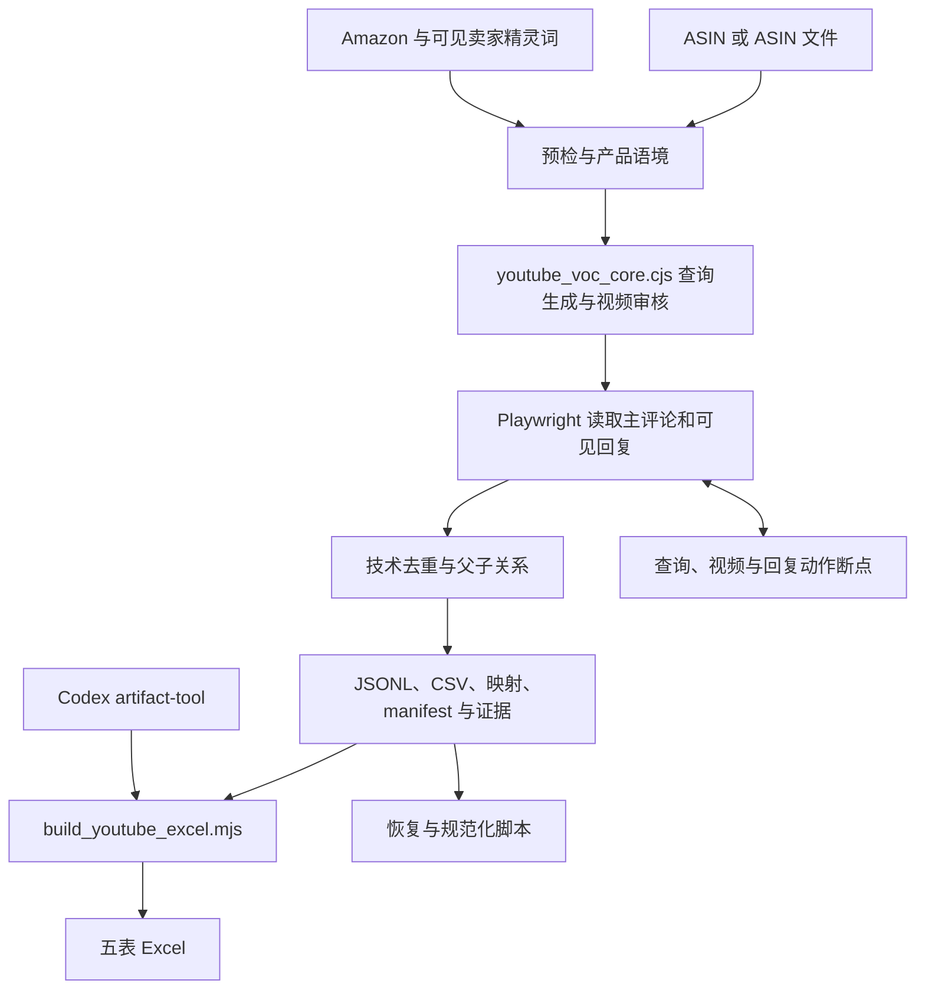

# YouTube VOC 评论采集器

## 一眼看懂

- 这是什么：按商品编号找 YouTube 公开视频并采评论。
- 什么时候用：想听视频评测和开箱里观众怎么说这款商品时。
- 给它什么：商品编号，和一个装好 Chrome 的电脑。
- 它给你什么：五张表的 Excel，含视频来源和评论回复。

## 项目简介

`youtube-voc-collector` 是由 Amazon US 商品驱动的 YouTube 公开评论采集工具，也可作为 Codex Skill 使用。输入单个 ASIN、ASIN 组或文件后，程序从当前商品标题、五点和可见卖家精灵词建立产品语境，发现相关公开视频，读取主评论和可见回复，输出可追溯的原始数据及 Excel。

本仓库承担采集层职责。评论相关性和审核状态是附加诊断字段，成功读取的原始评论仅做技术去重；视频用于来源追溯，不作为独立评论记录。

## 核心功能

- 合并单 ASIN、ASIN 组和文件输入，以当前产品名称、品类、属性、场景、问题、效果、材料、购买意图和替代品生成查询族。
- 审核视频与产品的关联，识别跨品类、错误物种、人类用途偏移和无关 ASMR 等结果。
- 读取公开主评论与可见回复，保存来源视频、作者、时间、直接父评论及深度。
- 按稳定评论 ID 去重；缺少 ID 时仅按 `video_id + author + comment_text` 完全一致去重，不做文本近似合并。
- 为每轮查询、视频状态和回复展开保存原子断点，保留候选池；续跑可合并新增扩展词并跳过已完成任务。
- 按配置限制视频数、评论数、回复动作和并发；未完成的视频保留 PARTIAL，已经读取的评论仍可交付。
- 输出 JSONL、CSV、查询计划、来源映射、manifest、checkpoint、逐视频证据与五表 Excel，并提供恢复与重建脚本。

Excel 工作表为 `Raw_Comments`、`Query_Plan`、`Video_Audit`、`Run_Summary`、`Quality_Gate`。质量检查针对字段、URL、父子关系、重复、记录类型和跨文件数量，不证明评论全量覆盖。

## 技术栈

| 用途 | 技术与仓库约束 |
| --- | --- |
| 采集与数据核心 | Node.js 22+；CI 使用 22，`package.json` 未声明 engines |
| 浏览器 | Playwright `>=1.55.0 <2`；默认本机 Google Chrome，也支持 Chromium |
| 规范化与 Skill 校验 | Python 3.10–3.13，PyYAML `>=6,<7`；`.python-version` 为 `3.12.13` |
| Excel 导出 | Codex 运行环境提供的 `@oai/artifact-tool`，不包含在 `package.json` 的公开依赖中 |
| Skill 安装与分发 | Windows PowerShell/CMD 脚本，版本 `1.1.0` |
| 测试 | unittest、Node test runner、GitHub Actions |

## 快速开始

### 在仓库中运行

准备 Node.js 22+、Python 3.10–3.13 和 Google Chrome：

```powershell
git clone https://github.com/fubo-ops/youtube-voc-collector.git
cd youtube-voc-collector
python -m venv .venv
.venv\Scripts\Activate.ps1
python -m pip install -r requirements.txt
npm ci
```

macOS/Linux 改用 `source .venv/bin/activate` 激活环境。默认使用已安装的 Chrome；如选择 `--channel chromium`，另执行 `npx playwright install chromium` 准备浏览器。

完整采集结束时会调用 Excel 构建器，因此还需提供 Codex 的 `@oai/artifact-tool`。构建器依次查找 `CODEX_ARTIFACT_TOOL_ENTRY`、`CODEX_ARTIFACT_NODE_MODULES`，再查找用户目录的 Codex bundled 默认路径。缺少该库时，仅安装 `requirements.txt` 和 npm 依赖不能完成 XLSX 导出。

### 可选安装为 Skill

```powershell
powershell -ExecutionPolicy Bypass -File .\install.ps1
powershell -ExecutionPolicy Bypass -File .\doctor.ps1
```

`install.ps1` 复制 Skill 文件到用户 skills 目录，会替换已有同名目录，需保留旧版本时先备份；它不安装 Python、Playwright 或 Excel 依赖。安装后采集仍需可解析 Playwright 的运行目录和上述 Codex 导出依赖。`doctor.ps1` 只检查安装文件、Node 语法和命令帮助，不证明浏览器访问或完整出表可用。

### 预检、采集与续跑

把 `ASIN` 替换为真实 10 位商品标识：

```powershell
node scripts/youtube_playwright_collector.cjs --help
node scripts/youtube_playwright_collector.cjs preflight --asin ASIN --headless 0 --profile-dir .youtube-voc-browser-profile
node scripts/youtube_playwright_collector.cjs --asin ASIN --target-comments 800 --videos-per-query 15 --max-comments-per-video 50 --max-reply-actions 15 --detail-concurrency 3 --headless 0 --profile-dir .youtube-voc-browser-profile
```

默认输出到当前目录的 `YouTube评论采集/<ASIN>`；可用 `--out-dir` 指定其他输出位置。批量使用 `--asins ASIN_A,ASIN_B` 或 `--asin-file asins.txt`。续跑传入该批实际 checkpoint 文件：

```powershell
node scripts/youtube_playwright_collector.cjs --asin ASIN --resume "YouTube评论采集/ASIN/RUN_checkpoint.json" --expanded-keywords "PRODUCT QUERY,USE CASE QUERY"
```

`RUN_checkpoint.json` 是路径占位符，应替换为实际生成文件。默认目标为 100 条评论、100 个视频、每查询 15 个视频、每视频 20 条评论、40 次回复动作、1 页详情并发与最多 3 轮发现；示例命令显式覆盖其中部分值。只使用公开可见内容，首次登录及验证码由使用者处理。

评论、店铺数据、浏览器资料、断点和输出文件不提交到 Git；合成预检 fixture 继续保留用于测试。

## 项目结构

以下完整结构对应 `git ls-files`，不含输出、浏览器资料和构建后的发布包：

```text
youtube-voc-collector/
├── .github/
│   └── workflows/
│       └── test.yml
├── .gitignore
├── .python-version
├── CHANGELOG.md
├── LICENSE
├── README.md
├── SECURITY.md
├── SKILL.md
├── VERSION
├── agents/
│   └── openai.yaml
├── build_release.ps1
├── doctor.ps1
├── install.cmd
├── install.ps1
├── package-lock.json
├── package.json
├── pyproject.toml
├── references/
│   ├── collection-guide.md
│   └── raw-record-schema.md
├── requirements.txt
├── scripts/
│   ├── build_youtube_excel.mjs
│   ├── normalize_raw_jsonl.py
│   ├── quick_validate.py
│   ├── rebuild_raw_collection.cjs
│   ├── youtube_playwright_collector.cjs
│   └── youtube_voc_core.cjs
├── tests/
│   ├── fixtures/
│   │   └── preflight-ready.json
│   ├── test_github_distribution.py
│   ├── test_release_distribution.py
│   ├── test_standalone_skill.py
│   └── test_youtube_voc_core.cjs
├── uninstall.cmd
└── uninstall.ps1
```

根目录 `CHANGELOG.md`、`SECURITY.md`、`VERSION` 与安装/卸载/发布脚本属于现有分发契约，保留原路径。当前没有需要迁移的过程文档或已跟踪运行产物，Skill 入口与 references 路径保持不变。

## 架构图



## 当前状态与开发计划

仓库版本为 `1.1.0`，已有产品驱动查询、视频审核、原始评论保存、断点恢复、质量检查、五表导出和 Windows Skill 分发脚本。离线测试覆盖查询、去重、评论父子关系、限制与断点、规范化、CLI 和分发契约；CI 配置了三个操作系统及 Python 3.10/3.13。

已准备依赖的环境可运行：

```bash
npm test
npm run check
python -B -m unittest discover -s tests -v
python -B scripts/quick_validate.py .
```

工作簿生成测试仅在检测到 Codex artifact-tool 时执行；PowerShell 安装、卸载和发布检查仅在 Windows 执行。跨平台离线测试不代表各平台浏览器实采已验收。在线效果受商品页面、卖家精灵、YouTube 可见内容和访问状态影响，真实业务环境验收记录待补充。

已有版本变化见 [更新记录](CHANGELOG.md)。独立的后续开发计划待补充。

## 文档

- [Skill 入口](SKILL.md)
- [采集参数、查询、停止与续跑规则](references/collection-guide.md)
- [原始评论字段与质量契约](references/raw-record-schema.md)
- [版本更新记录](CHANGELOG.md)
- [安全与数据边界](SECURITY.md)
- [安装脚本](install.ps1)与[环境检查](doctor.ps1)
- [发布打包脚本](build_release.ps1)
- [CI 配置](.github/workflows/test.yml)

## 许可证

采用 [MIT License](LICENSE)。
